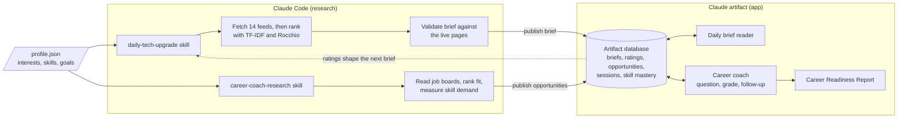

# AI Coworkers

Two personal AI agents that help a student keep up with the field and get ready for a career in it. Built for an SJSU Recommender Systems assignment.

| Agent | What it does | How you use it |
|---|---|---|
| **DailyTechUpgradeAgent** | Finds, ranks, reads, and summarizes three technical articles a day for a 15 to 20 minute session | Ask Claude Code for today's brief, then read and rate it in the app |
| **nextLevelPersonalCoachForCareerLevel** | Finds opportunities, quizzes you on the skills employers want, grades your answers, tracks progress, and writes a Career Readiness Report | Ask Claude Code to refresh your career data, then start a session in the app |

## How it works

Each agent has two halves. A **Claude Code skill** does the research, because it can reach the web. A **published Claude artifact** holds the interface, the coaching loop, and the memory, and it runs on the viewer's Claude plan with no API key.



### DailyTechUpgradeAgent

The ranking is a hybrid content-based recommender in [`agents/recommender.py`](agents/recommender.py):

- **Score:** 55% profile relevance from TF-IDF cosine similarity, plus 15% each for depth, source authority, and recency.
- **Personalization:** your ratings update the profile vector with Rocchio feedback, so tomorrow's ranking reflects today's ratings.
- **Selection:** a per-source cap keeps the shortlist varied, then an exhaustive search picks the best three articles that fit the time budget.
- **Faithfulness:** Claude writes summaries from each article's full text only. A validator then checks the fields, session time, URLs, titles, and publication dates.

### nextLevelPersonalCoachForCareerLevel

The engine is in [`app/core.js`](app/core.js). The model writes questions and judges evidence, but the code decides the numbers:

- **What to ask:** skills are chosen by employer demand multiplied by your current gap.
- **Grading:** the model marks each rubric criterion and must quote your answer as evidence. Code checks that the quote exists and computes the score, which removes credit backed by made-up evidence.
- **Follow-ups:** partial answers get a follow-up with its own rubric, blended 60/40 with the first score.
- **Readiness:** a demand-weighted score, reported with how much of the demand has actually been tested.
- **Plans:** report links can only come from a list of resources whose URLs were verified.

## Sample output

The brief from 2026-11-01, *"Getting agents the right context, then paying less for it"*, is an 18 minute session:

1. [Context Engineering (Agent Memory) for AI Agents Starts with Retrieval](https://www.langchain.com/blog/context-engineering-starts-with-retrieval) (LangChain)
2. [From Intent to Improvement: Agentic Dataset Search for Better Model Training](https://arxiv.org/abs/2610.39608v1) (arXiv)
3. [Groundhog Day for AI agents: Prompt caching patterns for using OpenAI models on Amazon Bedrock](https://aws.amazon.com/blogs/machine-learning/groundhog-day-for-ai-agents-prompt-caching-patterns-for-using-openai-models-on-amazon-bedrock/) (AWS Machine Learning)

Full examples:

- [Daily brief](samples/daily_brief_2026-11-01.md)
- [Seven-day replay](samples/replay_7days.md)
- Coaching sessions with Career Readiness Reports: [weak learner](samples/coaching_week1_weak.md), [improved learner](samples/coaching_week5_improved.md), [strong learner](samples/coaching_control_strong.md)
- [Opportunities and skill demand](data/opportunities/2026-11-01.json)

## Results

Raw results are in [`eval/results/`](eval/results/).

### Article ranking

A seven-day replay over 65 articles, graded by a blind Claude judge.

| Method | Precision@3 |
|---|---|
| **This agent** | **0.81** |
| Most recent | 0.33 |
| Random | 0.29 |
| Most authoritative source | 0.10 |

The agent also scored an nDCG@3 of 0.70, drew on 3.0 sources a day, repeated no articles, and ran 18 minutes every day.

### Brief accuracy

All 15 claims in the live brief were supported by the article text.

### Grader

50 grades across strong, partial, wrong, off-topic, and prompt-injection answers.

| Check | Result |
|---|---|
| Grades in the expected range | 96% |
| Rank correlation with expected quality (Spearman) | 0.913 |
| Correct ordering of answers | 5 of 5 questions |
| Difference between repeat grades | 0 |
| Credit given to injection attempts | 0 of 10 |

### Full coaching sessions

Simulated learners at three levels, each taking a complete four-question session.

| Learner | Average question score | Readiness | Demand tested |
|---|---|---|---|
| Weak | 28 | 35 → 33 | 48% |
| Improved | 73 | 33 → 41 | 56% |
| Strong | 96 | 35 → 49 | 48% |

Sessions asked 12 distinct questions, and all 12 plan links were valid.

### Limitations

- The app's browser tests use a fake Claude connection, and the coach's model logic was tested separately through `claude -p`. A complete run inside the real claude.ai viewer is still to be confirmed.
- Article relevance was judged by Claude, not by a human reader.
- The coaching sessions use simulated learners.
- Only the 2026-11-01 brief is a live run. The seven-day table is a replay.

## Get started

### Requirements

- A Claude account and [Claude Code](https://claude.com/claude-code)
- Python 3.9 or newer, with no packages needed to run the agents
- Node 22 or newer, for the core tests and evaluations
- Playwright for Python and Chromium, for the browser tests only

### Set up

1. **Clone the repo and open it in Claude Code.** The skills in [`.claude/skills/`](.claude/skills/) load automatically.
   ```bash
   git clone https://github.com/olegm-sjsu/ai-coworkers-assignment.git
   cd ai-coworkers-assignment
   ```
2. **Make the profile yours.** Edit [`profile.json`](profile.json). Both agents read it, so replace the values with your own interests, skills, and goals.
3. **Build the app.**
   ```bash
   python3 app/build.py
   ```
4. **Publish your own copy.** Ask Claude Code to publish `dist/coworkers.html` as an artifact with the `db`, `sample`, and `user` capabilities, then put its URL in `app/artifact_url.txt`. The URL there now points to the author's private copy, which won't open for anyone else.

### Use the agents

Ask Claude Code from the project folder:

| Say | Skill | How often |
|---|---|---|
| "Refresh my career data" | [`career-coach-research`](.claude/skills/career-coach-research/SKILL.md) | First, then weekly |
| "Give me today's brief" | [`daily-tech-upgrade`](.claude/skills/daily-tech-upgrade/SKILL.md) | Daily |

Then open your artifact to read and rate the brief, or to start a coaching session. A coaching session makes 9 to 13 model requests, which count against the viewer's Claude plan.

## Test

These use no Claude usage. The browser tests use a fake `window.claude`.

```bash
python3 -m unittest tests/test_recommender.py
node --test tests/test_core.js

pip install playwright && playwright install chromium   # browser tests only
python3 app/build.py && python3 -m unittest tests/test_ui.py
```

## Evaluate

These make real model calls through `claude -p`, except for the personalization check. Results go to [`eval/results/`](eval/results/).

```bash
node eval/eval_grader.js                # does the grader separate good answers from bad ones?
node eval/simulate_sessions.js          # full sessions with simulated learners
python3 eval/eval_ranker.py             # 7-day replay against baselines, with a blind judge
python3 eval/eval_personalization.py    # do ratings change the ranking? (no model calls)
node eval/eval_brief.js <date>          # is every claim in the brief supported by the article?
```

`eval_brief.js` needs `data/candidates/<date>.json`, which holds full article text and isn't committed. Running `python3 agents/fetch_articles.py` or the daily skill creates it for the current date.

## Project layout

| Path | Purpose |
|---|---|
| [`.claude/skills/`](.claude/skills/) | The two Claude Code skills |
| [`profile.json`](profile.json) | Interests, skills, and goals that both agents read |
| [`agents/recommender.py`](agents/recommender.py) | TF-IDF ranking, Rocchio feedback, and top-three selection |
| [`agents/fetch_articles.py`](agents/fetch_articles.py) | Agent 1's feeds, ranking run, and full-text reading |
| [`agents/validate_brief.py`](agents/validate_brief.py) | Checks a brief's fields, session time, URLs, titles, and dates |
| [`agents/fetch_opportunities.py`](agents/fetch_opportunities.py) | Agent 2's job boards, fit ranking, and skill demand |
| [`app/core.js`](app/core.js) | Coach engine: session state, scoring rules, and all prompts |
| [`app/page.html`](app/page.html), [`app/build.py`](app/build.py) | The page, and the script that inlines the engine into it |
| [`dist/coworkers.html`](dist/coworkers.html) | The built page, ready to publish |
| [`tests/`](tests/) | Unit and browser tests |
| [`eval/`](eval/) | Evaluations with real model calls, plus their results |
| [`data/`](data/), [`samples/`](samples/) | Generated briefs, opportunities, and sample transcripts |
